# AWS EC2 Cloud Infrastructure and Security

**Project type:** Academic cloud computing and security project
**Platform:** Amazon Web Services (AWS)
**Technologies:** EC2, IAM, S3, AWS CLI, AWS KMS, CloudTrail and CloudWatch

## 1. Project Overview

This project explored the deployment and security of cloud infrastructure using Amazon Web Services (AWS).

The work focused on understanding how cloud computing resources can be deployed, accessed, managed and monitored using AWS services.

## 2. Amazon EC2 Deployment

Amazon Elastic Compute Cloud (EC2) was used to explore the deployment of virtual computing resources within AWS.

The documented work included:

* Deploying an EC2 instance through the AWS Management Console.
* Establishing a remote connection to the instance.
* Installing and using the AWS Command Line Interface (CLI).
* Exploring cloud resource management through AWS.

## 3. Identity and Access Management (IAM)

AWS Identity and Access Management (IAM) was explored to understand how permissions and access to AWS resources are controlled.

The coursework documented the creation of an IAM role with the `AmazonS3FullAccess` managed policy.

This provided exposure to AWS identity management and permission assignment.

## 4. Amazon S3 and Data Security

Amazon Simple Storage Service (S3) was explored for cloud storage and data management.

The coursework considered:

* S3 bucket storage.
* Data transfer between AWS services.
* Server-side encryption using AWS Key Management Service (SSE-KMS).
* Protecting stored data through encryption.

The proposed data transfer workflow was considered as part of the project, rather than documented as a confirmed successful transfer.

## 5. AWS Monitoring and Logging

The project also explored AWS monitoring and logging services.

**AWS CloudTrail**

CloudTrail was considered for recording AWS account activity and API events, providing visibility into actions performed within the AWS environment.

**Amazon CloudWatch**

CloudWatch was explored for monitoring AWS resources and configuring alarms to help identify relevant operational events.

## 6. Skills Developed

This project provided academic and practical exposure to:

* AWS Management Console.
* Amazon EC2 virtual machines.
* AWS Command Line Interface.
* Identity and Access Management (IAM).
* Amazon S3 storage.
* AWS encryption concepts.
* AWS Key Management Service.
* CloudTrail logging.
* CloudWatch monitoring.
* Cloud infrastructure security.

## 7. Reflection and Future Improvements

This project helped develop my understanding of cloud infrastructure, access management, storage security and monitoring within AWS.

If I were to revisit the project, I would introduce more restrictive IAM permissions using the principle of least privilege, implement and verify the proposed data transfer workflow, and conduct additional monitoring and security tests.

I would also document the configurations and results in greater detail.

## 8. Project Classification

This was an academic project completed as part of my Big Data and Cloud Security coursework.

It was not a commercial cloud deployment or professional cloud administration assignment.

## 9. Project Screenshots

The following screenshots provide visual evidence of the AWS activities undertaken during this academic project.

They demonstrate the use of Amazon Web Services (AWS), including EC2 deployment, IAM configuration, cloud storage, security and monitoring.

Each screenshot is accompanied by a description explaining the activity and the AWS services involved.

### EC2 Cloud Instance Deployment

The following screenshots demonstrate the initial development of an Amazon EC2 cloud instance through the AWS Management Console.

The instance was launched to act as the main server for the fictional company, Fresh Mart. The initial configuration included an 8 GB storage volume as part of the proposed cloud infrastructure.

**Image 4 – EC2 Instance Configuration**

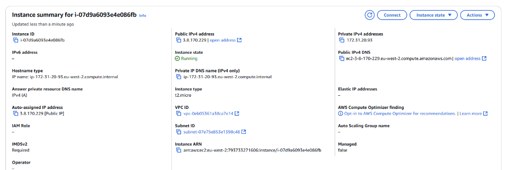

**Image 5 – EC2 Instance Deployment**

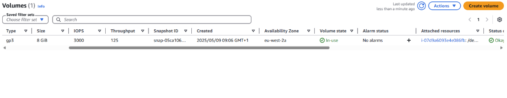

### Amazon S3 Bucket Creation

This screenshot demonstrates the creation of an Amazon S3 bucket for the fictional company, Fresh Mart. The bucket was intended to provide cloud storage for the project's data.

**Image 6 – Amazon S3 Bucket Creation**

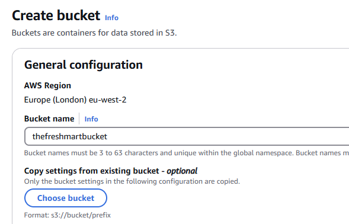

### Connecting to the EC2 Instance

The following screenshots demonstrate the process of connecting to the EC2 instance through the AWS Management Console using the Connect button.

This enabled remote access to the instance, allowing Fresh Mart to manage its settings, install and run programs, and access performance and analytics information.

**Image 7 – Initiating the EC2 Instance Connection**

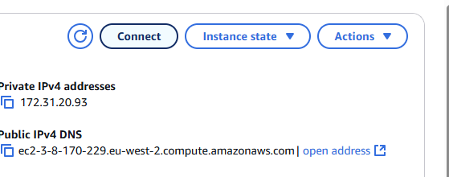

**Image 8 – Connecting to the EC2 Instance**

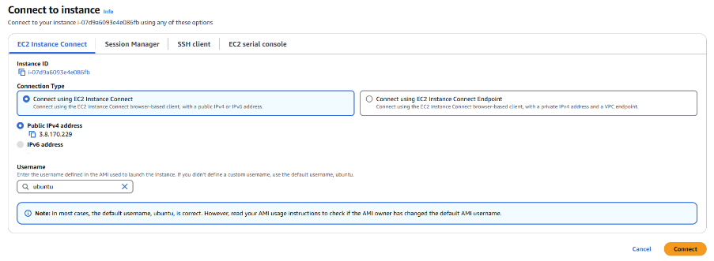

### Installing and Configuring AWS CLI

This screenshot demonstrates the use of the EC2 instance's terminal to install AWS Command Line Interface (AWS CLI).

AWS CLI allows users to manage and interact with AWS services through command-line instructions. The project used it to explore cloud administration, automation and data management.

**Image 9 – Installing AWS CLI on the EC2 Instance**

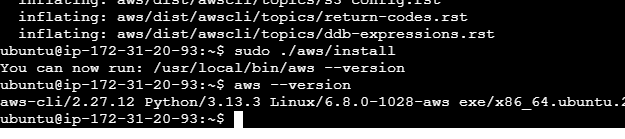

### Identity and Access Management (IAM) Configuration

The following screenshots demonstrate the setup and configuration of AWS Identity and Access Management (IAM).

IAM helps manage access to AWS resources by controlling permissions and determining what users and services can access. This was included in the project to improve access control and protect Fresh Mart's cloud resources.

**Image 10 – AWS IAM Configuration**

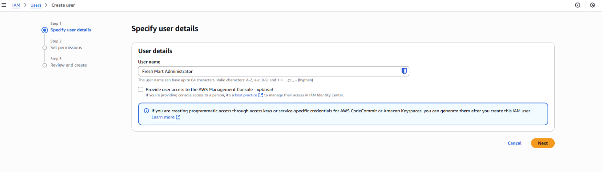

**Image 11 – IAM Security and Access Management**

### Creating an IAM Role for Amazon S3 Access

The following screenshots demonstrate the creation of a new IAM role using the `AmazonS3FullAccess` permission.

The role was intended to allow the EC2 instance to access Fresh Mart's S3 storage. IAM permissions help control access to AWS resources, reducing the risks associated with excessive or unauthorised access.

**Image 12 – Creating an IAM Role**

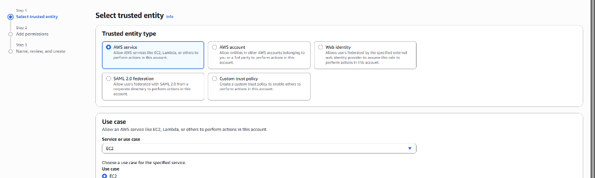

**Image 13 – Assigning AmazonS3FullAccess Permission**

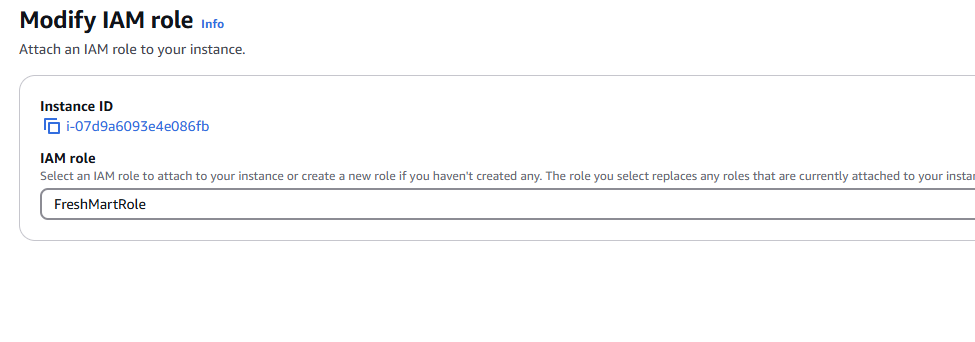

### Testing Data Transfer to Amazon S3

This screenshot demonstrates a successful data transfer from the EC2 instance to the Amazon S3 bucket using AWS CLI.

This allowed Fresh Mart to explore centralised cloud storage, where data from its 14 branches could be stored and accessed more easily. This approach could reduce reliance on physical storage infrastructure while supporting future scalability.

**Image 14 – Successful AWS CLI Data Transfer to S3**

## 10. Security Configuration

The EC2 instance and S3 storage required additional security configurations to help protect Fresh Mart's cloud infrastructure and business data.

### S3 Bucket Encryption (SSE-KMS)

The following screenshots demonstrate the security configuration of the Amazon S3 bucket using Server-Side Encryption with AWS Key Management Service (SSE-KMS).

This encryption method helps protect Fresh Mart's critical business data by encrypting stored information. SSE-KMS also provides additional control over encryption key management and permissions, helping the company manage who can access its encryption keys.

**Image 15 – Configuring S3 Bucket Encryption**

**Image 16 – SSE-KMS Encryption Configuration**

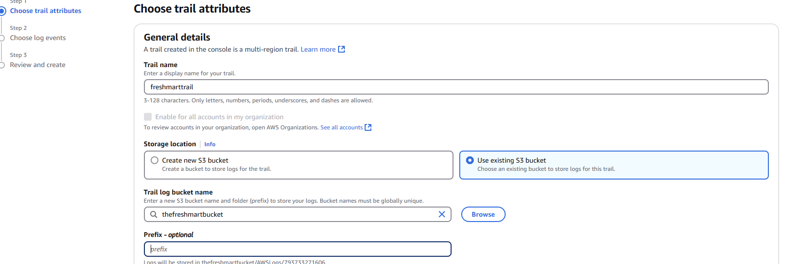

### AWS CloudTrail Logging

CloudTrail was included to record AWS account activity and API events. These logs help administrators review activity within their cloud environment and investigate potentially suspicious actions.

**Image 17 – AWS CloudTrail Configuration**

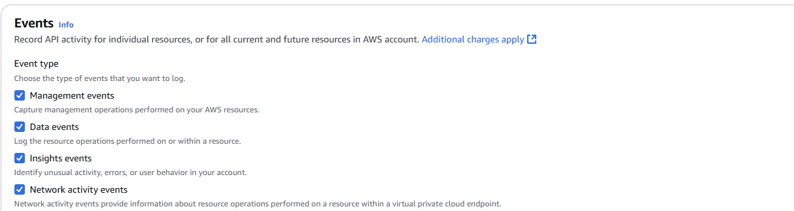

**Image 18 – CloudTrail Logging**

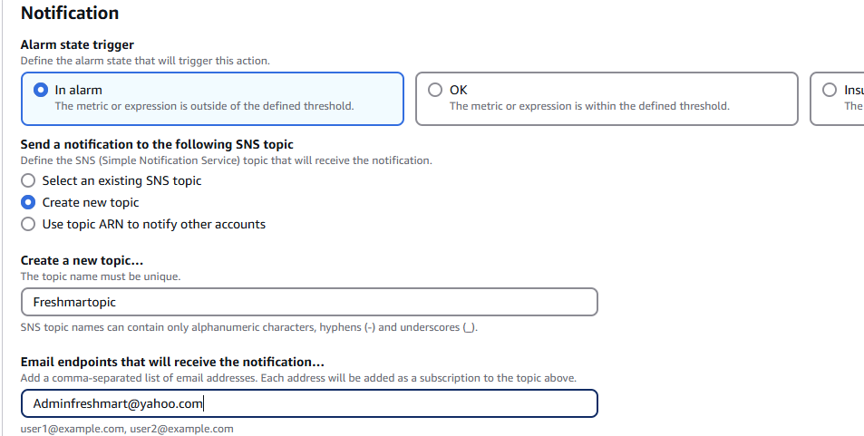

### AWS CloudWatch Monitoring and Alarms

CloudWatch was explored as a monitoring service for observing cloud resource performance and configuring alarms.

For Fresh Mart, this could help identify unusual resource usage or performance issues and notify administrators when configured thresholds are reached.

**Image 19 – AWS CloudWatch Monitoring**

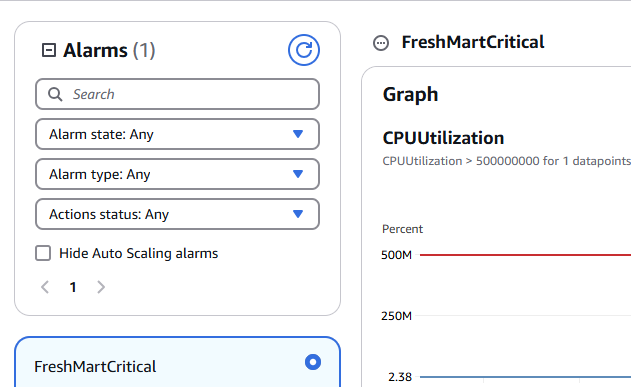

**Image 20 – CloudWatch Alarm Configuration**

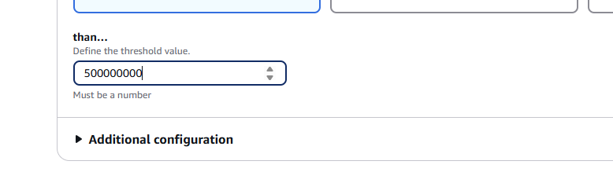

