# Network Design and Simulation Using Cisco Packet Tracer

**Project type:** Academic networking project
**Tools:** Cisco Packet Tracer
**Area:** Computer Networking

## 1. Project Overview

This project involved designing and simulating a computer network for a fictional financial services company called Digital Finance Services.

The objective was to develop a network design that could support different business departments, provide internal connectivity and establish communication with external network locations.

## 2. Network Design

The proposed network included:

* Local Area Network (LAN) infrastructure.
* Wide Area Network (WAN) connectivity.
* Routers and switches.
* Departmental computers.
* VLANs for departmental network separation.
* IP addressing and subnetting.
* DNS, web and email server considerations.
* An IPSec VPN concept for the HR department.

## 3. Implementation

Cisco Packet Tracer was used to construct and simulate elements of the proposed network.

The documented practical work included:

* Connecting network devices using copper straight-through cables.
* Configuring router interfaces.
* Assigning IP addresses to network devices.
* Working with VLAN configurations.
* Establishing a WAN connection between network locations.
* Using a /30 subnet mask for the documented WAN link.

## 4. Connectivity Testing

Ping commands were used to test connectivity between network devices and assess communication across the designed network.

These tests provided a basic way to check whether devices could communicate successfully.

## 5. Skills Developed

Through this project, I gained academic and practical exposure to:

* Cisco Packet Tracer.
* Network topology design.
* Router and switch configuration.
* IP addressing and subnetting.
* VLAN concepts.
* LAN and WAN connectivity.
* Basic network connectivity testing.
* Network infrastructure planning.

## 6. Reflection and Future Improvements

This project helped develop my understanding of how business networks are structured and how different network components communicate.

If I were to revisit the project, I would expand the practical implementation, introduce additional troubleshooting scenarios and provide more detailed evidence of device configurations and network testing.

I would also implement and test the proposed VPN configuration rather than treating it only as a design concept.

## 7. Project Classification

This was an academic project completed as part of my Computer Networks and Security coursework. It was not a commercial deployment or professional network administration assignment.

## 8. Project Screenshots
### LAN Implementation

The following screenshots demonstrate the creation of a Local Area Network (LAN) using Cisco Packet Tracer.

**Image 6 – LAN Setup**

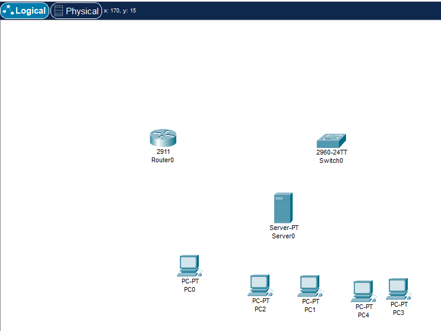

**Image 7 – LAN Configuration**

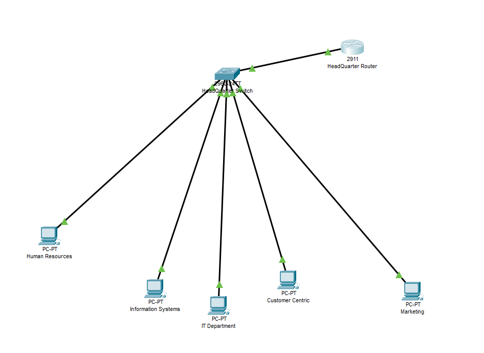

### Router and Switch Connectivity

These screenshots demonstrate the connection between the network switch and router using copper straight-through cables and Gigabit Ethernet interfaces.

The router was then configured through its Command Line Interface (CLI) to activate the relevant interface and establish the physical network connection.

**Image 8 – Router and Switch Connection**

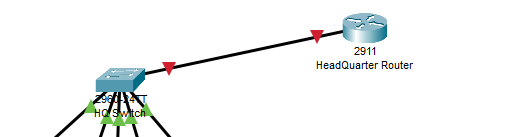

**Image 9 – Router Interface Configuration**

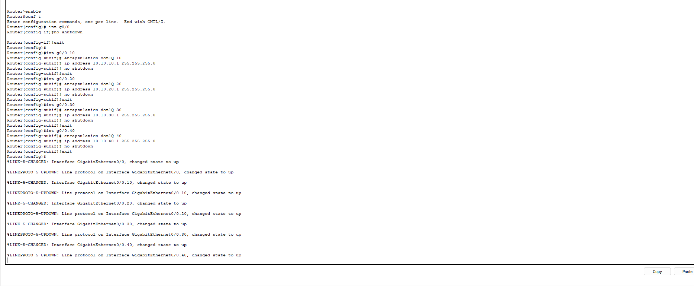

**Image 10 – Router Activation**

### VLAN Configuration and Departmental Connectivity Testing

The next stage involved checking and implementing VLANs for the company's internal departments.

IP addresses were assigned to help identify each departmental network and support communication and data transfers.

Finally, connectivity between the departmental networks was tested using the `ping` command through the Command Prompt.

**Image 11 – VLAN Configuration**

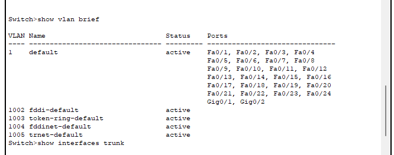

**Image 12 – Departmental IP Addressing**

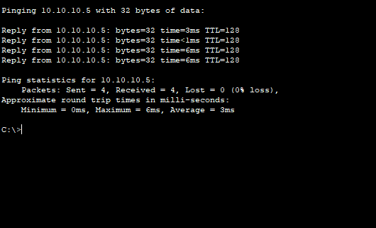

**Image 13 – Network Connectivity Testing**

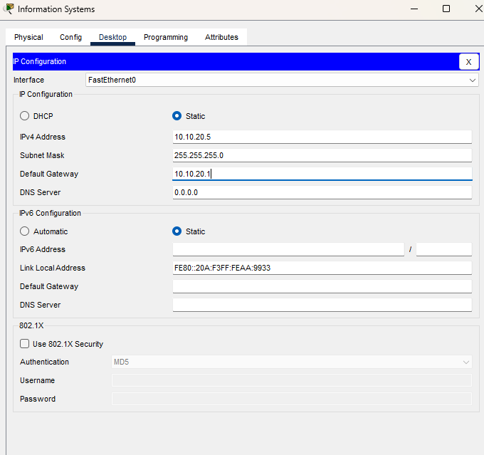

**Image 14 – Departmental Ping Test Results**

### WAN Development and External Connectivity

The next stage involved developing the Wide Area Network (WAN) to demonstrate connectivity between the company's headquarters and external locations.

The headquarters router acts as the connection point between the internal network and external establishments. This design allows different locations to communicate and supports the sharing and processing of business information across the network.

**Image 15 – WAN Network Design**

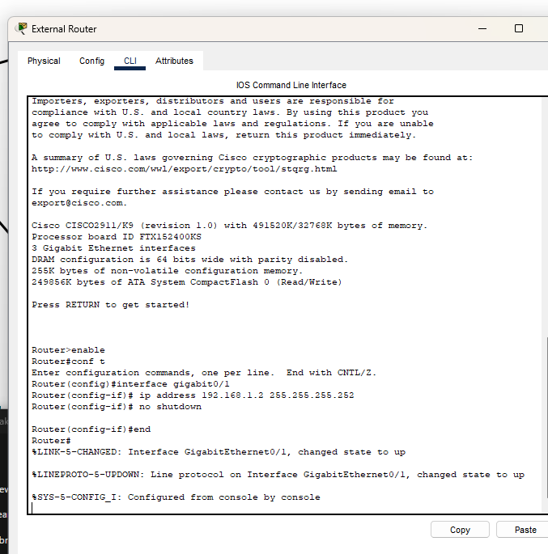

**Image 16 – Headquarters and External Site Connectivity**

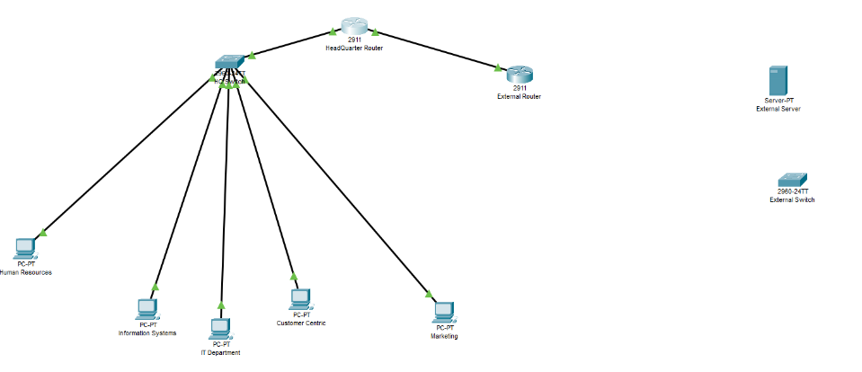

### WAN Router Configuration and Connectivity

The two routers were connected using Gigabit Ethernet interfaces and copper straight-through cables to establish the WAN connection.

IP addresses were then assigned to the router interfaces, and the configurations were activated to establish communication between the two network locations.

Both router interfaces displayed 100% completion in the documented configuration.

**Image 17 – WAN Router Connection**

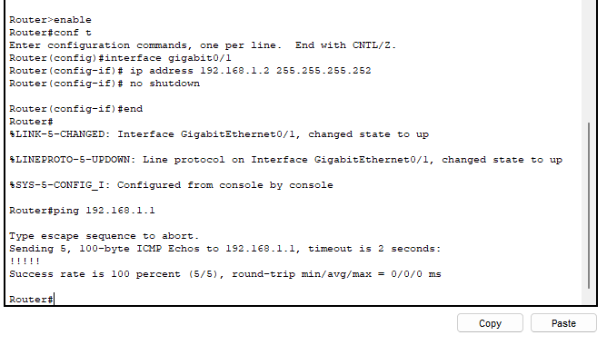

**Image 18 – Router IP Configuration**

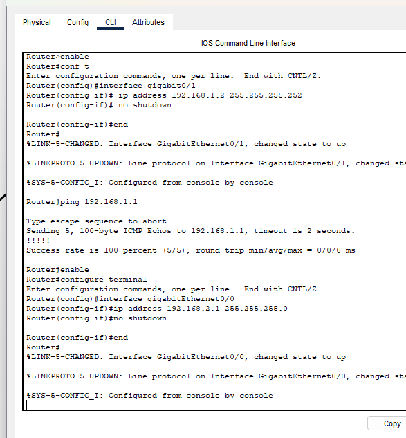

### IP Addressing, Subnetting and Final Network Design

To meet the technical requirements of Digital Finance Services, private IP addressing was used for the LAN networks to support internal communication, structured routing and network separation.

For the WAN connections, a subnet mask of `255.255.255.252` (`/30`) was configured. This provided a suitable address range for point-to-point router connectivity while minimising address wastage.

The overall network topology was designed to be straightforward for company engineers to understand and maintain. The headquarters acts as the central connection point for internal departments and external sites.

The design also considers future scalability, allowing additional computer systems to be introduced or removed as business requirements change.

Connectivity was assessed using commands such as `ping` to check communication between network devices.

**Image 19 – IP Addressing and WAN Subnetting**

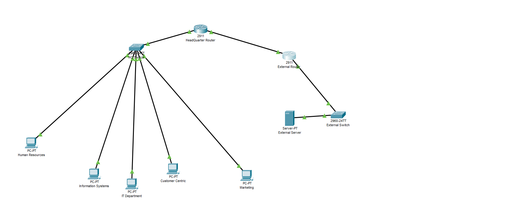

